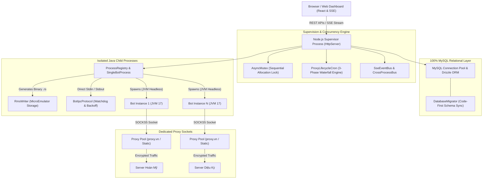

<div align="center">

# Avatar Multi-Bot Manager & Cloud Automation Platform

### Enterprise-grade 24/7 background game automation, multi-tenant rental engine, autonomous proxy lifecycle, and real-time liquid glass web dashboard for Avatar 2D.

[](https://nodejs.org/)
[](https://orm.drizzle.team/)
[](https://adoptium.net/)
[](https://payos.vn/)
[](docs/DEPLOYMENT_GUIDE.md)
[](LICENSE)

[Quickstart](#quickstart) · [System Highlights](#system-highlights) · [Engine Architecture](#engine-architecture) · [Documentation Hub](#documentation-hub) · [Deployment](#deployment) · [License](#license)

</div>

---

> [!IMPORTANT]
> **Production Runtime Notice:** The system runs fully headless using isolated Java 17 child processes. For cPanel or shared environments, deployment requires zero root privileges with the self-contained portable OpenJDK runtime. Ensure port and MySQL connection pool settings are configured in your environment file before launching.

---

## System Highlights

| Capability | Module | Technical Description |
| :--- | :--- | :--- |
| **Multi-Process Bot Runner** | `SingleBotProcess` | Supervises dozens of isolated Java Virtual Machine instances simultaneously. Memory crashes or thread locks in one account never affect neighboring bots or the web dashboard. |
| **Comprehensive Game Mod Suite** | `RmsWriter` & Game Jars | Direct binary generation of MicroEmulator `.rs` RecordStore files. Native support for Auto Diamond Mining (UPXU), Auto Fishing, Crop Farming, Animal Care, and Ore Selling. |
| **Autonomous Proxy Lifecycle** | `ProxyLifecycleCron` | 3-phase automated cronjob: releases expired slots, updates draining states, triggers 2-hour Waterfall Migration preserving server binding, auto-renews via proxy.vn, and eliminates idle costs. |
| **Multi-Tenant Rental Engine** | `ResourceAllocationEngine` | Dynamic Best-Fit Decreasing algorithm with `AsyncMutex` race condition immunity. Auto-balances loads between Hoàn Mỹ (HM) and Diệu Kỳ (DK) servers with pro-rata refund calculations. |
| **Instant 24/7 Wallet Billing** | `PayOsService` | Fully automated wallet top-up via NAPAS VietQR. Includes HMAC-SHA256 signature validation, database idempotency locks against double-crediting, and live Server-Sent Events balance sync. |
| **Liquid Glass Web Dashboard** | `HttpServer` & React UI | Porsche minimalist design with dual-canvas pixel avatar rendering, live Server-Sent Events (SSE) terminal streaming, dual profile management, and floating mobile dock. |
| **Pure MySQL Persistence** | `DrizzleDb` & `DatabaseMigrator` | 100% relational storage eliminating legacy file locks. Code-First automated schema migrations and connection pooling for concurrent requests. |

---

## Engine Architecture

The platform operates as a Node.js daemon supervising isolated Java ME environments running the AngelChip emulator:



---

## Quickstart

### 1. Clone & Configure Environment

```bash
git clone https://github.com/hoangbmt023/auto-server-manager-avatar2d-angleChip.git
cd auto-server-manager-avatar2d-angleChip
```

Copy the environment template:

```bash
cp .env.example .env.development
```

Configure your MySQL connection credentials in `.env.development`:

```env
PORT=3001
DB_HOST=localhost
DB_PORT=3306
DB_USER=root
DB_PASSWORD=your_mysql_password
DB_NAME=avatar_2d_bot_manager
APP_SECRET=your_super_secret_32_character_key
```

### 2. Launch Application

```bash
# Development (with Code-First Auto-Migration)
npm run dev

# Production
npm run prod
```

Open your browser at **`http://localhost:3001`**.

---

## Documentation Hub

Deep-dive operational and technical documentation is organized in the [`docs/`](docs/) directory:

| Document | Description |
| :--- | :--- |
| [**System Design & Execution Pipeline**](docs/SYSTEM_DESIGN.md) | Multi-process runner, `.rs` binary format specification, dual-canvas graphics, IPC protocol, and Watchdog backoff algorithms |
| [**Rental Engine & Proxy Lifecycle**](docs/RENTAL_AND_PROXY_LIFECYCLE.md) | Dynamic Best-Fit allocation, 3-phase Cronjob, Waterfall Migration rules, Prorated refund math, and anti-abuse safeguards |
| [**RESTful API & Event Specification**](docs/API_SPECIFICATION.md) | Comprehensive endpoint reference, Server-Sent Events (SSE) schemas, and payOS webhook signature validation |
| [**Database Schema & Persistence**](docs/DATABASE.md) | Complete MySQL entity relationship diagram (ERD), table columns, indexing strategies, and automated migrations |
| [**Production Deployment Guide**](docs/DEPLOYMENT_GUIDE.md) | Step-by-step setup on cPanel Hosting (Setup Node.js App), Linux VPS (Systemd), Windows local setup, and low-footprint JVM tuning |
| [**UI/UX Design Engine**](docs/DESIGN.md) | Porsche minimalist liquid glass design tokens, dual-canvas character extraction, and vector iconography |

---

## Deployment Options

* **cPanel Hosting**: Run directly via **Setup Node.js App** (Phusion Passenger wrapper `app.js`). Supports zero-root standalone OpenJDK 17 execution. See the [cPanel Deployment Guide](docs/DEPLOYMENT_GUIDE.md#2-deploying-on-cpanel-via-setup-nodejs-app).
* **Linux VPS (Ubuntu / Debian)**: Deploy with systemd daemon management and headless virtual framebuffer. See the [Linux VPS Guide](docs/DEPLOYMENT_GUIDE.md#3-deploying-on-linux-vps-ubuntu-2204--debian-12).
* **Windows Workstation**: Run natively using standard Command Prompt or PowerShell with installed JDK 17 and MySQL.

---

## License

This project is licensed under the [MIT License](LICENSE).
