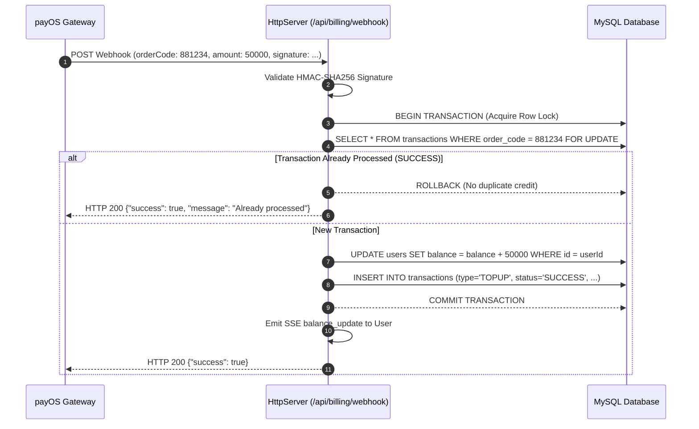

# RESTful API & Real-time Event Specification

> Complete technical reference for the HTTP REST endpoints, Server-Sent Events (SSE) streaming protocol, payOS webhook validation, and security middleware pipeline.

---

## 1. Response Standards

All HTTP endpoints return standardized JSON payloads for predictability across client applications.

### Success Envelope (`ApiResponse`)

```json
{
  "success": true,
  "message": "Operation completed successfully",
  "data": { ... },
  "pagination": null
}
```

### Validation Error Envelope (HTTP 400 - `ErrorResponse.validation`)

```json
{
  "success": false,
  "message": "Invalid request parameters",
  "errors": {
    "username": "Tên tài khoản không được để trống!",
    "serverId": "Máy chủ không hợp lệ (0: Hoàn Mỹ, 1: Diệu Kỳ)!"
  }
}
```

### Business Exception Envelope (HTTP 4xx / 5xx)

```json
{
  "success": false,
  "message": "Tài khoản bot đang chạy, không thể thực hiện thao tác!",
  "errors": null
}
```

---

## 2. Security Middleware Pipeline

Incoming HTTP requests pass through three security boundary guards:

1. **CORS Whitelisting (`corsMiddleware.js`)**: Dynamic origin verification matching `CORS_ALLOWED_ORIGINS` in `.env`.
2. **Timing-Attack Immune Auth (`authMiddleware.js`)**: Constant-time string comparison (`crypto.timingSafeEqual`) on session and API tokens.
3. **Payload Sanitization (`bodyParserMiddleware.js`)**: Anti-DoS request size limits (`MAX_PAYLOAD_SIZE_MB`) and prototype pollution sanitization.

---

## 3. Server-Sent Events (SSE) Protocol

Real-time terminal logs, in-game stat counters, and wallet balance notifications stream over a persistent HTTP connection.

### Connection Endpoint: `GET /api/bot/logs/stream`

#### Required Request Headers
```http
Accept: text/event-stream
Cache-Control: no-cache
```

#### Response Handshake Headers
```http
HTTP/1.1 200 OK
Content-Type: text/event-stream; charset=utf-8
Cache-Control: no-cache, no-transform
Connection: keep-alive
X-Accel-Buffering: no
Access-Control-Allow-Origin: *
```

> [!IMPORTANT]
> The `X-Accel-Buffering: no` header is essential. It instructs upstream reverse proxies (Nginx, LiteSpeed, Cloudflare) not to buffer stream chunks, ensuring log lines arrive in the browser with sub-second latency.

### Event Message Schemas

#### 1. Heartbeat Ping (`event: ping`)
Dispatched every 25 seconds to keep intermediary proxy connections alive:
```json
{
  "time": 1714152000000
}
```

#### 2. Process Log Line (`event: log`)
```json
{
  "accountId": "018f3a2c-1234-7000-8000-000000000001",
  "username": "avatar_player1",
  "message": "[avatar_player1] Đã câu được 1 Cá Lóc (+2,500 xu)",
  "type": "stdout",
  "timestamp": "2026-10-26T20:00:00.000Z"
}
```

#### 3. Real-time Balance Top-up (`event: balance_update`)
Triggered automatically when a payOS or VietQR payment is confirmed:
```json
{
  "userId": "018f3a2c-9999-7000-8000-000000000002",
  "balance": 150000,
  "change": 50000,
  "orderCode": 1714152001
}
```

---

## 4. REST Endpoint Catalog

### Authentication (`/api/auth`)

| Method | Endpoint | Auth | Description |
| :--- | :--- | :--- | :--- |
| `POST` | `/api/auth/register` | Public | Register new user account |
| `POST` | `/api/auth/login` | Public | Authenticate user & return JWT token |
| `POST` | `/api/auth/refresh` | Public | Refresh expired JWT access token |
| `POST` | `/api/auth/logout` | User | Invalidate session refresh token |
| `GET` | `/api/auth/me` | User | Retrieve current user profile & balance |

### Bot Process Management (`/api/bot`)

| Method | Endpoint | Auth | Description |
| :--- | :--- | :--- | :--- |
| `POST` | `/api/bot/start/:id` | User | Spawn Java process for specified account |
| `POST` | `/api/bot/stop/:id` | User | Stop running Java process for specified account |
| `POST` | `/api/bot/start-all` | User | Batch launch all idle accounts in current profile |
| `POST` | `/api/bot/stop-all` | User | Batch stop all active accounts in current profile |
| `GET` | `/api/bot/logs/history/:id` | User | Fetch buffered log history for account |
| `GET` | `/api/bot/stats` | User | Aggregate CPU, memory, and running bot metrics |

### Account & Slot Management (`/api/accounts`)

| Method | Endpoint | Auth | Description |
| :--- | :--- | :--- | :--- |
| `GET` | `/api/accounts` | User | List accounts with filtering, search, and pagination |
| `POST` | `/api/accounts` | User | Create a new game account profile |
| `GET` | `/api/accounts/:id` | User | Get detailed configuration of an account |
| `PUT` | `/api/accounts/:id` | User | Update account credentials or mod settings |
| `DELETE` | `/api/accounts/:id` | User | Delete account and purge orphan RMS files |
| `POST` | `/api/accounts/:id/reset` | User | Reset accumulated coin and heart counters |
| `POST` | `/api/accounts/:id/sync-rms` | User | Re-generate RMS binary stores without restarting |

### Multi-Tenant Rental Engine (`/api/rental`)

| Method | Endpoint | Auth | Description |
| :--- | :--- | :--- | :--- |
| `GET` | `/api/rental/pricing` | Public | Get active plans, duration discounts, and cancel fee |
| `POST` | `/api/rental/rent` | User | Rent a new bot slot (allocates file, proxy, server) |
| `POST` | `/api/rental/cancel` | User | Cancel rented slot with pro-rata wallet refund |
| `GET` | `/api/rental/my-slots` | User | List all active rented slots belonging to current user |

#### Example: Rent Slot Request (`POST /api/rental/rent`)
```json
{
  "plan": "UPXU",
  "durationMonths": 3,
  "username": "pro_farmer_01",
  "password": "secret_password",
  "serverId": 0,
  "voucherCode": "SALE20"
}
```

### Billing & Automated payOS Payments (`/api/billing`)

| Method | Endpoint | Auth | Description |
| :--- | :--- | :--- | :--- |
| `POST` | `/api/billing/topup` | User | Create payOS payment checkout link & QR code |
| `POST` | `/api/billing/webhook` | Public | payOS automated payment confirmation callback |
| `GET` | `/api/billing/transactions` | User | Retrieve personal wallet transaction ledger |
| `POST` | `/api/billing/vouchers/apply` | User | Validate voucher code against plan & duration |

### Proxy Pool Management (`/api/proxies`)

| Method | Endpoint | Auth | Description |
| :--- | :--- | :--- | :--- |
| `GET` | `/api/proxies` | Admin | List all proxies with health metrics and bot loads |
| `POST` | `/api/proxies` | Admin | Add static SOCKS5 / HTTP proxy to pool |
| `POST` | `/api/proxies/test-all` | Admin | Trigger asynchronous health check on all proxies |
| `POST` | `/api/proxies/:id/test` | Admin | Test latency and connectivity for single proxy |
| `DELETE` | `/api/proxies/:id` | Admin | Remove proxy from pool |
| `GET` | `/api/proxies/stats` | Admin | Pool capacity metrics (HM / DK usage ratios) |

### Admin Resource Allocation Control (`/api/admin/allocations`)

| Method | Endpoint | Auth | Description |
| :--- | :--- | :--- | :--- |
| `GET` | `/api/admin/allocations` | Admin | View real-time bot distribution across proxies & files |
| `POST` | `/api/admin/allocations/rules` | Admin | Update pricing tiers, discounts, and proxy strategy |

---

## 5. payOS Webhook Security & Idempotency Guarantee

The webhook endpoint (`POST /api/billing/webhook`) receives bank payment confirmations 24/7. To guarantee absolute security against forged requests and duplicate wallet credits:

### HMAC-SHA256 Signature Verification

1. Extract all payload fields except `signature`.
2. Sort keys alphabetically (`amount`, `cancelUrl`, `description`, `orderCode`, `returnUrl`).
3. Construct query string format: `amount=50000&cancelUrl=...&orderCode=123456`.
4. Generate HMAC-SHA256 digest using `PAYOS_CHECKSUM_KEY`.
5. Compare against incoming `signature` using constant-time string comparison (`crypto.timingSafeEqual`). If signatures do not match, reject immediately with HTTP 400.

### Database Idempotency Lock



Even if network retries cause payOS to deliver the same webhook multiple times, the database unique index on `order_code` combined with `SELECT ... FOR UPDATE` prevents double-crediting under all conditions.
