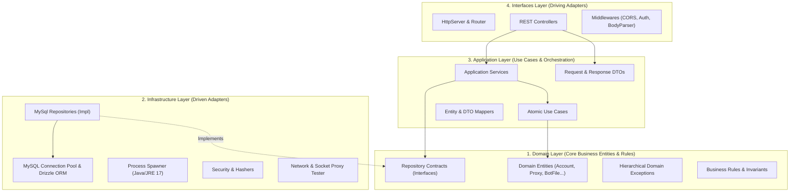

# 🏗️ Backend Clean Architecture & System Structure

> Comprehensive technical breakdown of the Clean Architecture, Domain-Driven Design (DDD), and modular folder structure powering the Avatar Multi-Bot Manager.

---

## 🏛️ Architecture Overview

The system strictly adheres to **Clean Architecture** (Robert C. Martin) and **Hexagonal Architecture (Ports and Adapters)**. The fundamental rule is the **Dependency Rule**: *Source code dependencies must point only inward, toward higher-level policies.*



---

## 📁 Complete Folder Structure

```text
test-cpanel-avatar/
├── .env.development            # Development environment configuration
├── .env.production             # Production environment configuration (cPanel)
├── server.js                   # Node.js process entrypoint
├── app.js                      # Startup wrapper for cPanel Setup Node.js App
├── package.json                # Project manifest and scripts
│
├── config/                     # Centralized Configuration & Environment Hub
│   ├── envLoader.js            # Zero-dependency multi-env file reader (.env.<env>)
│   ├── env.js                  # Intermediate Env Layer (type parsing, fallback, guards)
│   ├── index.js                # Immutable domain-grouped config (app, db, security, cors, java)
│   └── drizzle.config.js       # Drizzle ORM CLI config (reads from config.db)
│
├── docs/                       # Technical & Architectural Documentation
│   ├── ARCHITECTURE.md         # Clean Architecture & folder hierarchy (this file)
│   ├── DATABASE.md             # MySQL Database schema & Drizzle ORM engine
│   ├── API_SPECIFICATION.md    # RESTful API endpoints, DTOs & Middlewares
│   ├── CPANEL_DEPLOYMENT.md    # Deployment guide on cPanel Node.js Selector
│   └── DESIGN.md               # Porsche & Apple Liquid Glass UI Design System
│
├── jars/                       # Java Virtual Machine runtime assets
│   ├── emulator/               # MicroEmulator / AngelChip Java emulator jar
│   └── games/                  # Avatar 2D game mod jars (Fish, Farm, Diamond)
│
├── public/                     # High-performance Liquid Glass React Frontend
│   ├── index.html              # Shell HTML with vector icon injection
│   ├── style.css               # Core design tokens and global reset
│   └── src/
│       ├── App.jsx             # Root React Application
│       ├── api/api.js          # Unified Axios-like API Client
│       ├── context/            # AppContext, ModalContext
│       ├── components/         # Modular presentation components
│       └── styles/             # Component-scoped CSS modules
│
└── src/                        # Backend Clean Architecture Engine
    ├── domain/                 # Core Domain (Zero External Dependencies)
    │   ├── entities/           # Account, Proxy, BotFile, User, SystemSetting
    │   ├── errors/             # AppException, ValidationException, NotFoundException...
    │   ├── repositories/       # IAccountRepository, IProxyRepository, IUserRepository...
    │   └── rules/              # AccountLimitRule (Max 3 acc/server/IP)
    │
    ├── application/            # Application Use Cases & Workflows
    │   ├── dtos/               # Request & Response DTOs categorized by domain
    │   ├── mappers/            # Domain <-> DTO <-> Persistence Mappers
    │   ├── services/           # AccountService, ProxyService, AuthService, FileProfileService
    │   └── use-cases/          # StartBotAccountUseCase, StopBotAccountUseCase...
    │
    ├── infrastructure/         # Technical Infrastructure (Driven Adapters)
    │   ├── database/           # MySqlConnectionPool, DrizzleDb, DatabaseMigrator
    │   ├── persistence/mysql/  # MySQL Repository implementations
    │   ├── process/            # MultiBotManager, JavaDetector, JreManager
    │   ├── security/           # PasswordHasher, EncryptionService
    │   ├── logging/            # SseEventBus (Server-Sent Events)
    │   ├── network/            # ProxyTester (SOCKS5/HTTP socket checker)
    │   └── storage/            # RMS binary storage manager
    │
    ├── interfaces/             # Driving Adapters (API & Web Gateways)
    │   └── http/
    │       ├── controllers/    # AccountController, ProxyController, BotController...
    │       ├── routes/         # RESTful route definitions
    │       ├── middlewares/    # corsMiddleware, authMiddleware, bodyParserMiddleware
    │       ├── helpers/        # errorHandler.js (Central 4xx vs 500 handler)
    │       ├── Router.js       # Zero-dependency HTTP router
    │       └── HttpServer.js   # IoC Composition Root & Server bootstrap
    │
    └── shared/                 # Shared Utilities & Helpers
        └── utils/              # Time, string, and formatting utilities
```

---

## 🛡️ Architectural Principles & Guarantees

1. **Separation of Concerns (SoC)**: Business logic lives exclusively within Domain and Application layers. The HTTP framework, database drivers, and operating system calls are strictly isolated in Infrastructure and Interfaces.
2. **Dependency Inversion Principle (DIP)**: Application Services depend only on Repository Interfaces (`IAccountRepository`), never on MySQL, Drizzle, or file drivers directly.
3. **Fail-Fast DTO Validation**: Every HTTP request is sanitized and validated at the boundary before executing use cases.
4. **Single Responsibility (SRP)**: Controllers only parse incoming HTTP data, delegate to services, and serialize JSON responses.
