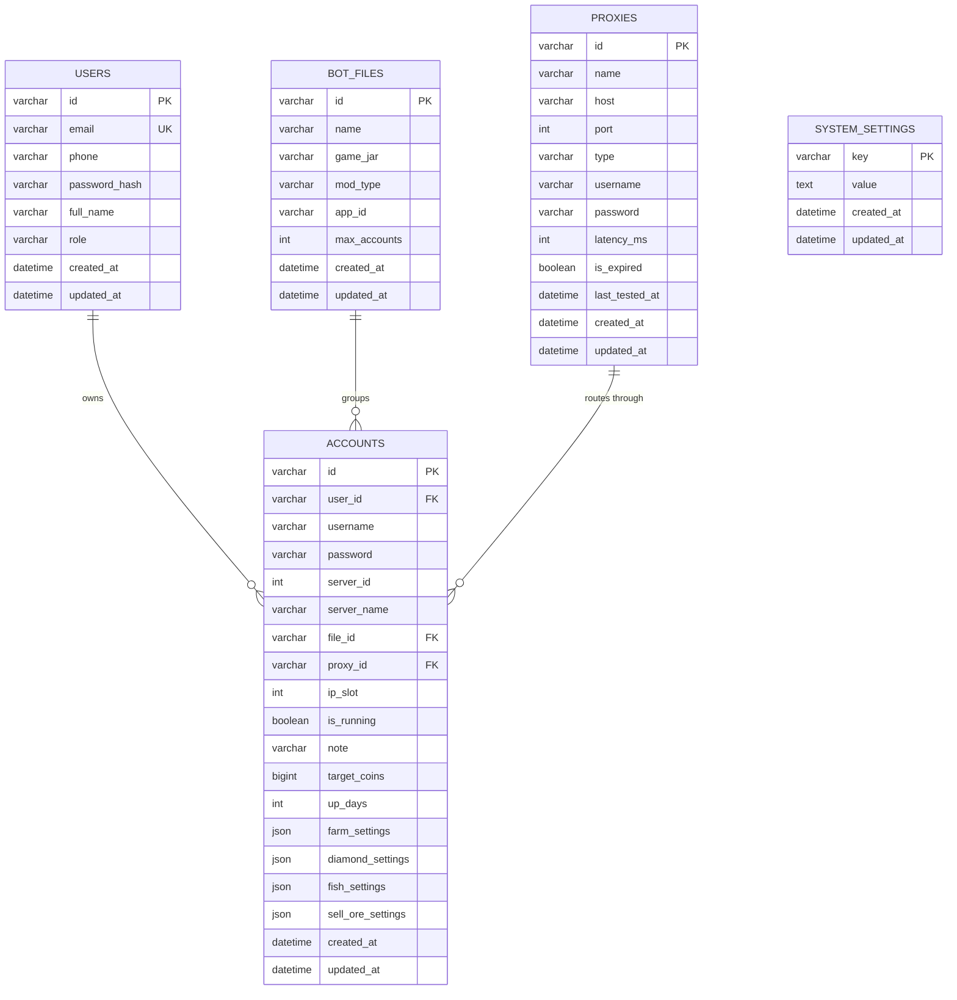

# 🗄️ Database Architecture & MySQL Persistence

> Technical reference for the Database persistence layer, Drizzle ORM schema, Code-First Migrator, and Connection Pooling.

---

## 🚀 Overview

The system runs **100% on MySQL relational database** with zero runtime file dependencies (`config.json` is completely eliminated). All persistence operations use parameterized queries via **MySQL2 Connection Pool** and **Drizzle ORM** for type safety and SQL injection immunity.

---

## 📊 Database Schema Entity-Relationship (ERD)

---

## 🛠️ Schema Definitions

### 1. `accounts`
Stores Avatar game credentials, server allocations, assigned proxies, and specialized automation parameters:
* `server_id`: `0` for Hoàn Mỹ (Server 1), `1` for Diệu Kỳ (Server 2).
* `ip_slot`: Position within the Tab IP allocation (1 - 6 nick / IP).
* `farm_settings`, `diamond_settings`, `fish_settings`, `sell_ore_settings`: JSON structured configurations.

### 2. `proxies`
Manages SOCKS5 / HTTP networking tunnels:
* Realtime health check metadata (`latency_ms`, `is_expired`, `last_tested_at`).
* Multi-account routing (supports up to 6 bots per proxy: 3 HM + 3 DK).

### 3. `bot_files`
Represents bot profile groupings and JAR mod associations (`chipmix`, `fish`, `upxu`).

### 4. `system_settings`
Key-Value configuration storage:
* Web port, memory limits, auto-start flags, and dashboard access tokens.

---

## 🔄 Code-First Migrator & Auto-Seeding

On server startup, `DatabaseMigrator.js`:
1. Checks connectivity to the configured MySQL host (`DB_HOST`, `DB_PORT`, `DB_NAME`).
2. Automatically executes code-first schema definitions (`CREATE TABLE IF NOT EXISTS`).
3. Seeds initial configuration defaults if the database is newly initialized.
