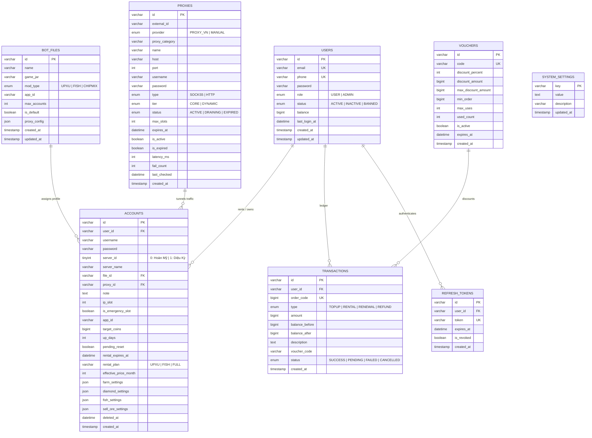

# Database Schema & Persistence Architecture

> Technical reference for the 100% MySQL persistence layer, Drizzle ORM entity definitions, Code-First schema migrations, and indexing strategies.

---

## 1. Storage Architecture Overview

The platform uses a pure **MySQL relational database** architecture with zero runtime file dependencies (`config.json` locks and file corruptions are completely eliminated).

All persistence operations utilize parameterized SQL queries executed through a **MySQL2 Connection Pool** with **Drizzle ORM** for schema definition, transaction management, and SQL injection immunity.

---

## 2. Entity-Relationship Diagram (ERD)

---

## 3. Table Schema & Column Definitions

### `users`
Stores user identities, administrative credentials, role authorizations, and wallet balances in VND.

* **Primary Key:** `id` (UUIDv7 string).
* **Indexes:** `idx_users_email` (Unique), `idx_users_phone`, `idx_users_role_status`.
* **Important Invariant:** `balance` uses `BIGINT` to prevent precision loss. Balance mutations are executed strictly via atomic transactions (`UPDATE users SET balance = balance + ? WHERE id = ?`).

### `accounts`
Stores bot account credentials, server assignment, proxy bindings, mod configurations, and rental expiration timestamps.

* **Primary Key:** `id` (UUIDv7 string).
* **Server Logic:** `server_id = 0` corresponds to **Hoàn Mỹ (HM)**; `server_id = 1` corresponds to **Diệu Kỳ (DK)**.
* **Foreign Keys:**
  * `user_id` $\rightarrow$ `users(id)` (`ON DELETE SET NULL`).
  * `file_id` $\rightarrow$ `bot_files(id)` (`ON DELETE CASCADE`).
  * `proxy_id` $\rightarrow$ `proxies(id)` (`ON DELETE SET NULL`).
* **Soft Deletes:** Rented slots and accounts utilize `deleted_at`. When a rental contract expires or is cancelled, `deleted_at` is set, preserving financial audit trails.

### `proxies`
Maintains the pool of SOCKS5 and HTTP routing proxies.

* **Status Lifecycle:** `ACTIVE` $\rightarrow$ `DRAINING` (Lease expires in $\le 2$ hours) $\rightarrow$ `EXPIRED`.
* **Tier Distinction:**
  * `CORE`: Static administrative proxies that never auto-terminate.
  * `DYNAMIC`: On-demand proxies auto-purchased via `proxy.vn` with automatic lifecycle management.

### `transactions`
Provides an immutable double-entry ledger for all financial movements across the platform.

* **Order Code:** `order_code` (`BIGINT`) stores unique bank transfer or payOS transaction codes.
* **Types:** `TOPUP` (Wallet deposit), `RENTAL` (Slot purchase), `RENEWAL` (Slot extension), `REFUND` (Prorated slot cancellation).

---

## 4. Code-First Schema Auto-Migration Engine (`DatabaseMigrator`)

The system does not require manual `.sql` migration scripts to run upon deployment. On server bootstrap (`npm run dev` or `npm run prod`), `DatabaseMigrator`:

1. Verifies database connectivity and auto-creates the schema if absent.
2. Compares declarative table definitions in `CodeFirstSchema.js` against MySQL `information_schema.columns`.
3. Safely executes non-destructive `ALTER TABLE ADD COLUMN` or `CREATE TABLE` commands.
4. Auto-seeds default administrative credentials and initial bot file profiles if the database is newly initialized.
