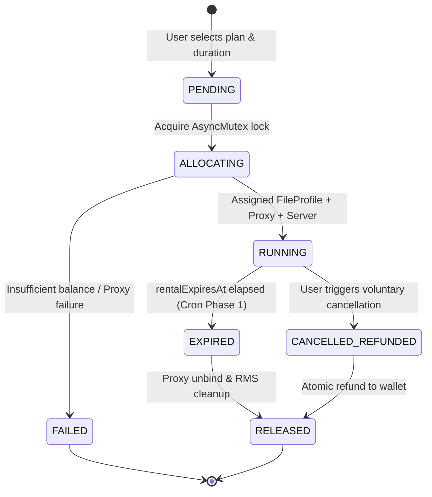
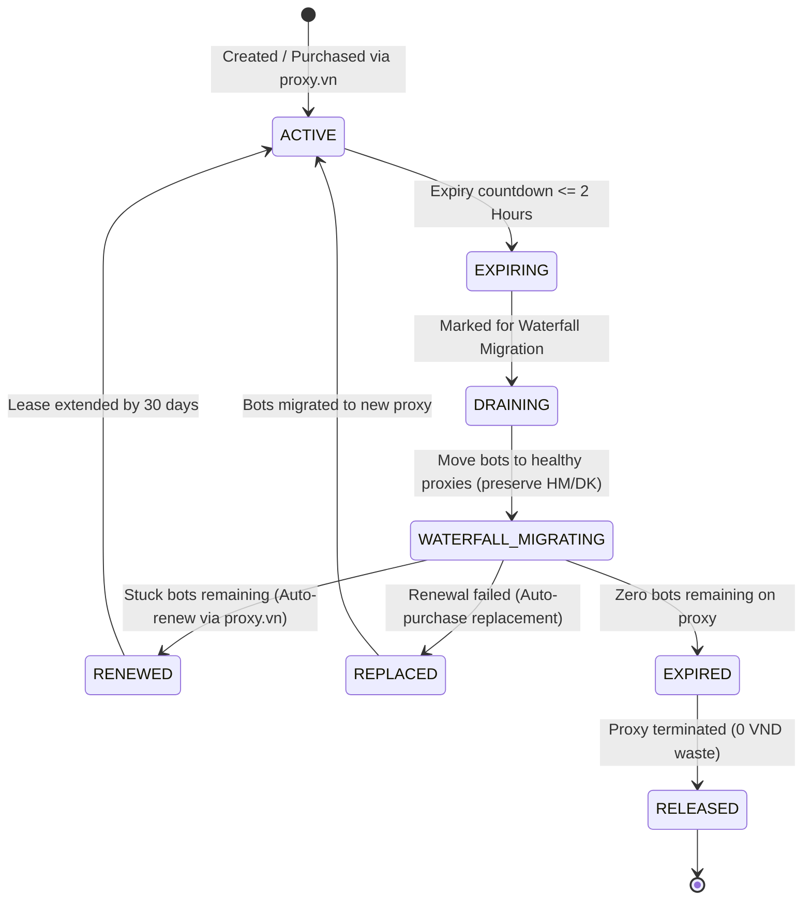
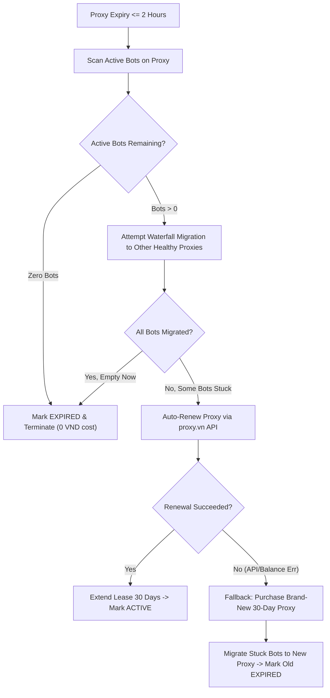

# Rental Engine & Autonomous Proxy Lifecycle

> Technical specification for the multi-tenant slot allocation engine, Best-Fit scoring, Prorated refund economics, and the 3-phase autonomous proxy lifecycle cron with waterfall migration.

---

## 1. Slot Rental Lifecycle

Every rented bot slot moves through an automated state machine ensuring deterministic resource allocation, strict game server balancing, and transactional refund safety.



---

## 2. Dynamic Resource Allocation Engine (`ResourceAllocationEngine`)

When a user rents or renews a slot, the system must assign:
1. A **Bot File Profile** (e.g. `file_1`, `file_2` based on mod type: `UPXU`, `FISH`, or `FULL`).
2. A **Network Proxy** (SOCKS5 / HTTP from `proxies` pool).
3. A **Game Server** (`0`: Hoàn Mỹ - HM, `1`: Diệu Kỳ - DK).

### Concurrency Protection (`AsyncMutex`)

To eliminate race conditions (such as multiple simultaneous rental requests purchasing duplicate proxies from `proxy.vn` or exceeding the strict 6-bot cap per proxy), all allocation decisions execute sequentially inside `AsyncMutex.globalAllocationMutex`.

### Best-Fit Decreasing Allocation Algorithm

The engine calculates an allocation score for each active proxy in the database to maximize proxy utilization:

```text
Target: Fill almost-full proxies first before opening new ones (Best-Fit Decreasing).
Constraint: Maximum 6 bots per proxy (3 Hoàn Mỹ + 3 Diệu Kỳ).
Zero Direct IP: Every bot MUST run behind a validated proxy.
```

The algorithm evaluates candidates according to:
1. **Tier Priority**: Prefer `CORE` static proxies over `DYNAMIC` auto-purchased proxies.
2. **Server Headroom**: Ensure target server capacity `< 3` on this proxy (`count(HM) < 3` and `count(DK) < 3`).
3. **Capacity Score**: Assign highest priority to proxies currently at `5/6` slots, followed by `4/6`, `3/6`, down to `0/6`.
4. **On-Demand Auto-Purchase**: If all active proxies have reached full capacity (`>= 6` bots or server limits saturated), the engine triggers an automated purchase call to `ProxyVnApiClient` to provision a new 30-day Datacenter proxy.

---

## 3. Prorated Refund Economics & Anti-Abuse Guards

When a tenant cancels an active bot rental before its expiration date, the system executes an automated, fair pro-rata refund.

### Mathematical Formulation

Given:
* $\Delta t_{\text{remaining}}$: Remaining active duration in seconds ($\text{rentalExpiresAt} - \text{now}$).
* $T_{\text{month}}$: Standard billing month duration ($30 \times 86,400 = 2,592,000$ seconds).
* $P_{\text{effective}}$: Actual price paid per month (recorded at purchase, accounting for duration discounts and vouchers).
* $F_{\text{fee}}$: Configurable cancellation fee percentage (default: `10%`).

$$\text{GrossRefund} = \left\lfloor \left( \frac{\Delta t_{\text{remaining}}}{T_{\text{month}}} \right) \times P_{\text{effective}} \right\rfloor$$

$$\text{CancellationFee} = \left\lfloor \frac{\text{GrossRefund} \times F_{\text{fee}}}{100} \right\rfloor$$

$$\text{NetRefund} = \max\left(0, \, \text{GrossRefund} - \text{CancellationFee}\right)$$

### Anti-Abuse & Rate-Limiting Guards

To prevent users from exploiting the system to rotate through dirty IP addresses or manipulate server loads:

1. **Minimum Hold Duration (`minHoldHours = 1h`)**:  
   A newly rented slot cannot be cancelled within the first 60 minutes of creation. If attempted, the API rejects the request with HTTP 400 indicating the remaining cooldown period.
2. **Transaction Atomicity (`TransactionManager`)**:  
   Slot deletion, proxy unbinding, balance credit, and transaction ledger entry occur inside a single MySQL transaction (`withTransaction`) protected by an exclusive mutex. Double-refund requests are rejected immediately.
3. **Orphan RMS Purge**:  
   When a slot is cancelled, `RmsWriter.cleanAccountRmsDirs` cleans up residual `.rs` binary suites unless another active account in the system shares the same game username.

---

## 4. Autonomous Proxy Lifecycle & Waterfall Migration (`ProxyLifecycleCron`)

To maintain zero downtime for long-term bots while eliminating unnecessary infrastructure costs, `ProxyLifecycleCron` runs periodically (every 30 minutes) executing a 3-phase automated cycle.

### Proxy State Machine



---

## 5. The 3-Phase Cron Execution Breakdown

### Phase 1: Contract Expiration Sweep
* Scans `accounts` table for slots where `rentalExpiresAt < NOW()` and `deleted_at IS NULL`.
* Gracefully stops the corresponding `SingleBotProcess`.
* Marks slot as expired and frees the proxy seat (`proxyId = null`).
* Emits SSE event to notify the user.

### Phase 2: Status Synchronization
* Identifies proxies with expiration time within the next 2 hours.
* Updates database status from `ACTIVE` to `DRAINING` badge.
* Broadcasts updated proxy pool metrics to admin dashboards.

### Phase 3: The 2-Hour Final Decision Engine

When a proxy has $\le 2$ hours of life remaining:



### Strict Server Preservation Rule

During Waterfall Migration, the engine **strictly preserves server assignments**:
* Accounts on server **Hoàn Mỹ (HM)** are migrated exclusively to destination proxies that have `count(HM) < 3`.
* Accounts on server **Diệu Kỳ (DK)** are migrated exclusively to destination proxies that have `count(DK) < 3`.
* A bot is never switched between HM and DK during migration. If no healthy proxy has capacity on the bot's current server, the bot remains in place and triggers proxy auto-renewal.
