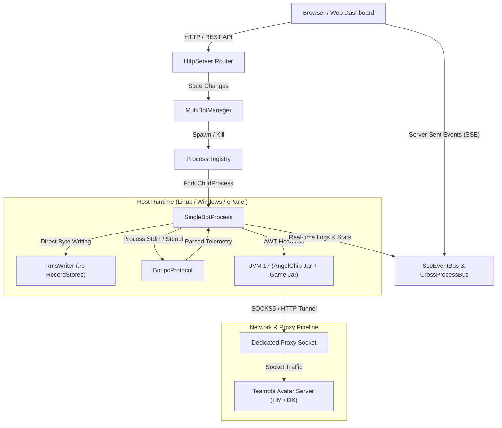
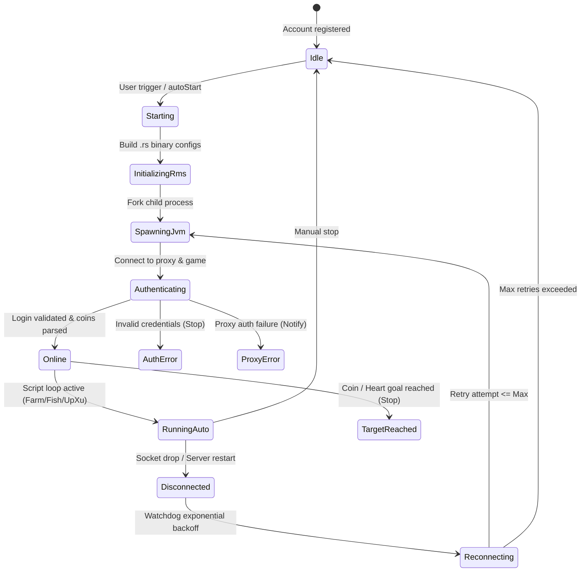
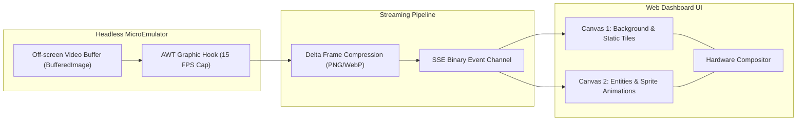
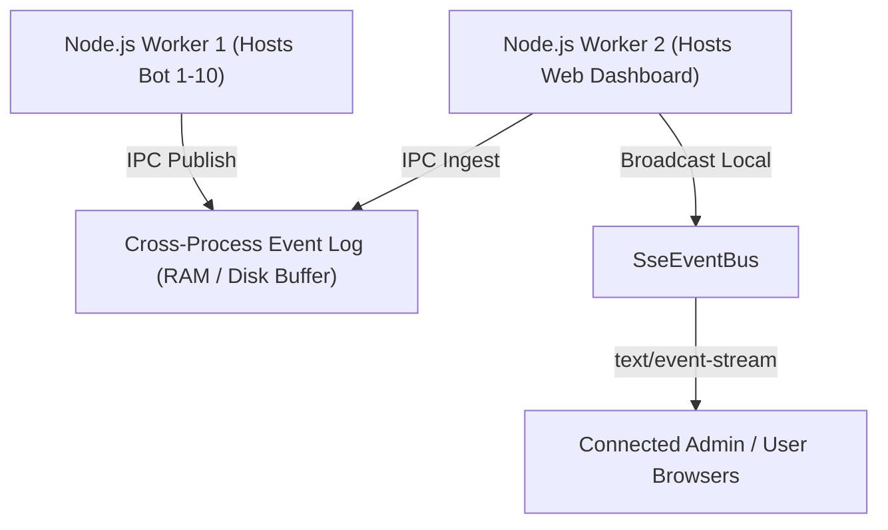

# System Design & Engine Execution Pipeline

> Comprehensive technical breakdown of the multi-process bot execution engine, binary RMS storage, dual-canvas graphic rendering, IPC protocol, and runtime supervision in Avatar Multi-Bot Manager.

---

## 1. High-Level Engine Architecture

The platform operates as a persistent daemon supervising dozens of isolated Java Virtual Machine (JVM) instances. Each instance executes the AngelChip MicroEmulator runtime loading an Avatar 2D game binary.



---

## 2. Java Process Isolation & Lifecycle (`SingleBotProcess`)

Each game account is executed inside its own dedicated child process. This guarantees that a crash, memory leak, or thread hang in one game instance has zero impact on other running accounts or the web control panel.

### Execution Command Breakdown

When launching a bot account, `SingleBotProcess` constructs the command line arguments:

```bash
java \
  -Djava.awt.headless=true \
  -Dmicroemulator.display=headless \
  -Dmicroemulator.recordstore=filesystem \
  -Dmicroemulator.rms.path=.microemulator/suite-avatar_<username>_<fileId> \
  -DsocksProxyHost=<proxy_host> \
  -DsocksProxyPort=<proxy_port> \
  -Djava.net.socks.username=<proxy_user> \
  -Djava.net.socks.password=<proxy_pass> \
  -Xms32m \
  -Xmx64m \
  -XX:+UseSerialGC \
  -jar jars/emulator/AngelChipEmulator_V2Proxy.jar \
  avatar_main \
  jars/games/<game_jar>
```

### Process Supervision State Machine



---

## 3. MicroEmulator RMS Binary Format (`RmsWriter`)

Avatar 2D saves player credentials, mod configuration, starting currency, and farming timers into Java ME RecordStore (`.rs`) files located on the file system. `RmsWriter` directly generates and updates these binary files before launching the Java process, bypassing manual in-game configuration.

### FileSystemRecordStore Binary Layout

Every `.rs` file follows the strict binary format of MicroEmulator's `FileSystemRecordStore`:

| Offset (Bytes) | Field Name | Data Type | Endianness | Description |
| :--- | :--- | :--- | :--- | :--- |
| `0x00 .. 0x01` | `nameLength` (`N`) | `UInt16` | Big-Endian | Length in bytes of the RecordStore identifier string |
| `0x02 .. (0x02 + N - 1)` | `recordStoreName` | `UTF-8 String` | -- | ASCII / UTF-8 name of the record store |
| `(0x02 + N) .. +3` | `version` | `Int32` | Big-Endian | RecordStore version identifier (always `1`) |
| `+4 .. +11` | `lastModified` | `Int64` | Big-Endian | Milliseconds epoch timestamp of last write |
| `+12 .. +15` | `nextRecordId` | `Int32` | Big-Endian | ID assigned to the next record (always `2`) |
| `+16 .. +19` | `numRecords` | `Int32` | Big-Endian | Total records stored in file (always `1`) |
| `+20 .. +23` | `recordSize` (`S`) | `Int32` | Big-Endian | Length in bytes of the record 1 payload |
| `+24 .. +(24 + S - 1)` | `recordPayload` | `Binary Data` | Big-Endian | Mod-specific payload bytes |

*Total Header Size:* `2 + N + 24` bytes.

### Mod-Specific Payload Offsets

#### Up Thue Data (`chip_<username>Data.rs` & `chip_Data.rs` - 28 Bytes Payload)

Used by the bot mod to calculate coins earned and session duration:

| Byte Offset | Field | Type | Description |
| :--- | :--- | :--- | :--- |
| `0x00 .. 0x03` | `xuBanDau` | `Int32BE` | Starting coin balance recorded at session start |
| `0x04 .. 0x0B` | `startedTs` | `Int64BE` | Timestamp when farming began (epoch ms) |
| `0x0C .. 0x0F` | `upDays` | `Int32BE` | Configured duration in days |
| `0x10 .. 0x13` | `targetCoins` | `Int32BE` | Target coin quota (stops bot when reached) |
| `0x14 .. 0x1B` | `lastUpdateTs` | `Int64BE` | Timestamp of the most recent sync |

#### Up Thue Stats Reset (`chip_<username>Coin.rs` - 8 Bytes Payload)

| Byte Offset | Field | Type | Description |
| :--- | :--- | :--- | :--- |
| `0x00 .. 0x03` | `earnedCoins` | `Int32BE` | Total coins collected in session (reset to `0`) |
| `0x04 .. 0x07` | `collectedHearts` | `Int32BE` | Total hearts collected (reset to `0`) |

#### Directory Hierarchy & Safety Locks

```text
.microemulator/
├── suite-avatar_<username>_<fileId>/
│   ├── chip_<username>Data.rs
│   ├── chip_<username>Coin.rs
│   ├── chip_Data.rs
│   ├── chip_Coin.rs
│   ├── farm_<username>.rs
│   └── kc_<username>.rs
```

> [!IMPORTANT]
> **Anti-Collision Guard:** When deleting an account or releasing a rental slot, `RmsWriter.cleanAccountRmsDirs` scans all active database slots. If another active slot shares the same in-game username, the RMS suite is preserved to prevent catastrophic data loss.

---

## 4. Dual-Canvas Graphic Rendering Engine

For accounts running on headless environments where visual verification is required, the system employs a dual-canvas graphic rendering architecture.



### Key Optimizations

1. **Dual-Layer Separation**: Static tilemaps (farm terrain, market stalls) are cached on the Background Canvas and only redrawn upon map transition. Only dynamic sprites (characters, fish, countdown labels) are drawn onto the Foreground Canvas.
2. **Delta Throttling**: If no state changed between ticks, frames are dropped to conserve server CPU and client network bandwidth.
3. **Bandwidth Guard**: On mobile viewports or when the tab is backgrounded, frame extraction frequency drops from 15 FPS to 1 FPS automatically.

---

## 5. Process IPC Protocol (`BotIpcProtocol`) & Watchdog

Because Java ME games run as closed processes, Node.js supervises them by writing commands to `stdin` and parsing structured log strings from `stdout`/`stderr`.

### Outbound Commands (`Node.js` -> `Java stdin`)

| Command Signature | Payload | Description |
| :--- | :--- | :--- |
| `START_AUTO <type>` | `farm`, `kc`, `fish`, `sell_ore` | Starts specific automated gameplay routine |
| `STOP_AUTO` | None or `<type>` | Pauses or halts current auto script |
| `SETUP <targetCoins> <upDays>` | Numeric parameters | Updates target coins and uptime in-game |
| `FARM_SETTINGS <json>` | Soil, seed, and harvest flags | Configures crop rotation and animal care |
| `DIAMOND_SETTINGS <json>` | Area, tool, mining speed | Configures underground mining parameters |
| `FISH_SETTINGS <json>` | Rod ID, bait type, location | Configures fishing spot and bait loop |
| `RESET_DATA` | None | Resets accumulated coin and heart counters |

### Inbound Telemetry Packets (`Java stdout` -> `Node.js`)

`BotIpcProtocol.parseLine` detects and consumes specific packet signatures:

1. **`[ACCOUNT_STATUS]: { "state": "online" | "disconnected" | "maintenance", "isTargetReached": boolean }`**  
   Updates the top-level status badge and evaluates if the quota has been completed.
2. **`[AUTO_STATUS]: { "isRunning": boolean, "autoType": "farm" | "fish" | "diamond", "subTask": string }`**  
   Updates in-game mod activity (e.g., returning from diamond mine to water crops).
3. **`[PLAYER_STATS]: { "coins": number, "gold": number, "farmingCountdown": string, "kcx": string }`**  
   Synchronizes live statistics into the dashboard card without database writes.

### Watchdog Exponential Backoff Algorithm

When an unexpected socket drop occurs (`MẤT KẾT NỐI`, `SocketTimeoutException`, `ConnectException`), the Watchdog handles recovery using an exponential backoff schedule with jitter:

$$\text{Delay}(n) = \min\left(\text{MaxDelay}, \text{BaseDelay} \times 2^{n}\right) \pm \text{Jitter}$$

* **Base Delay**: 5,000 ms (5 seconds).
* **Max Delay**: 120,000 ms (2 minutes).
* **Jitter**: $\pm 1,500$ ms randomized to avoid synchronized reconnection storms (thundering herd problem) against the game server.
* **Max Retries**: 5 consecutive failures before moving the account to `idle` with an alert notification.

---

## 6. Real-time Event Streaming (`SseEventBus` & `CrossProcessBus`)

Logs and metrics are delivered to the browser using Server-Sent Events (SSE). To ensure compatibility with multi-worker environments (such as Phusion Passenger on cPanel or PM2 cluster mode), events are synchronized across worker processes.



* **Heartbeat**: A `ping` event is emitted every 25 seconds to keep intermediary proxy connections alive.
* **No Buffering**: Headers include `X-Accel-Buffering: no` and `Cache-Control: no-cache` to force reverse proxies (Nginx, LiteSpeed) to flush chunks immediately.
